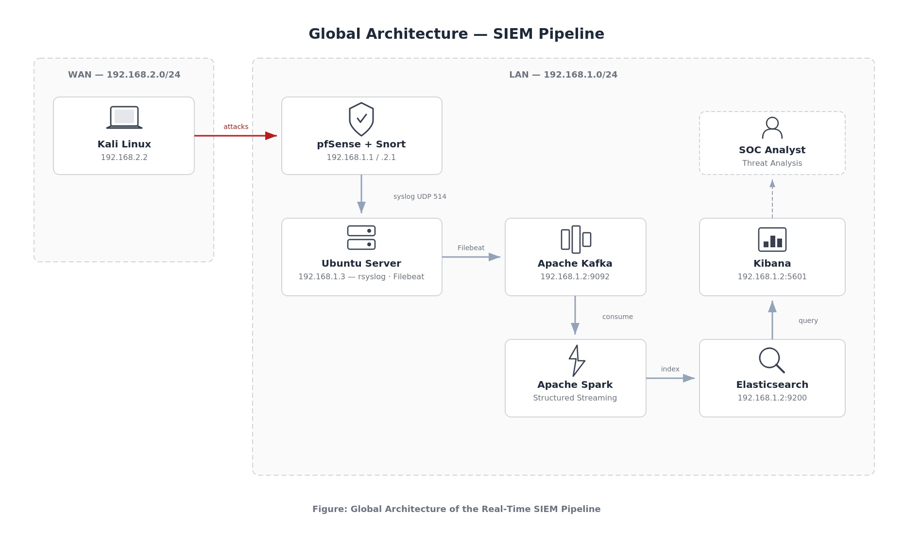
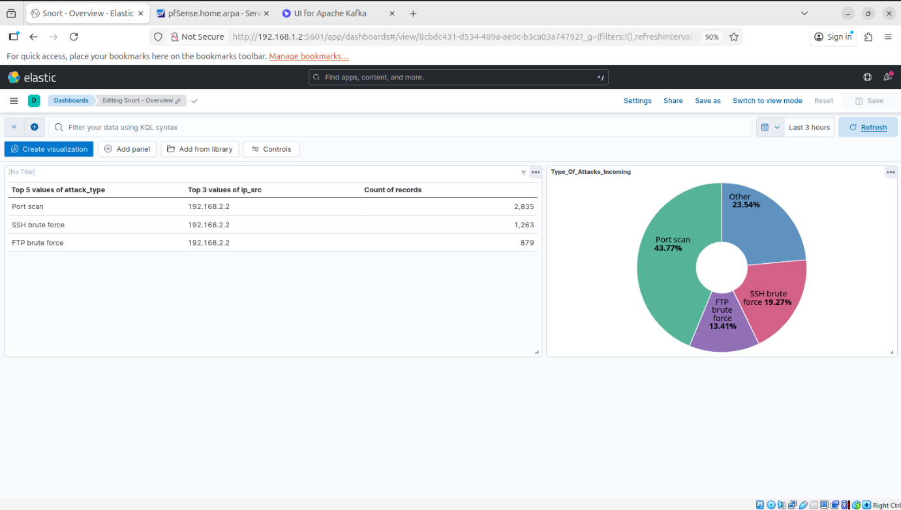
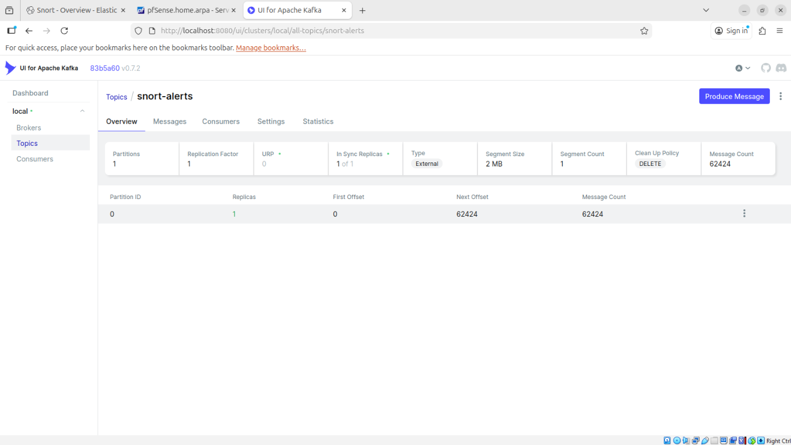

# Real-time SIEM pipeline: Snort, Kafka, Spark and ELK

A security monitoring pipeline built from open-source components: intrusion alerts and logs are
collected from a pfSense firewall, streamed through Kafka, processed with Spark Structured Streaming,
indexed in Elasticsearch and classified in Kibana. Detection was validated with attacks launched
from Kali Linux.

I started this as a personal project in late 2025. Tunisie Telecom adopted it during my internship
(January 2026), and I finished and validated it under their supervision.

## Data flow

1. **pfSense + Snort** (192.168.1.1) detects suspicious traffic and sends all its logs by syslog
   (UDP 514) to the Ubuntu Server.
2. **Rsyslog** on the Ubuntu Server (192.168.1.3) writes them to `/var/log/snort/snort.log`.
3. **Filebeat** tails that file and publishes each line to the Kafka topic `snort-alerts`.
4. **Kafka** (192.168.1.2:9092, Docker) buffers the events, so collection and processing are
   decoupled and a slow consumer does not cause data loss.
5. **Spark Structured Streaming** (Python job on 192.168.1.2) reads the topic, adds an ingestion
   timestamp and host field, and writes each event to the Elasticsearch index `snort-fraud`.
6. **Kibana** (192.168.1.2:5601) parses source IP, destination IP and attack type with runtime
   fields (Painless scripts) and displays them on a dashboard.

| Machine | Address | Role |
|---|---|---|
| pfSense + Snort | LAN 192.168.1.1 / WAN 192.168.2.1 | Firewall, IDS, syslog source |
| Ubuntu Server | 192.168.1.3 | Rsyslog collector, Filebeat; SSH and FTP targets |
| Ubuntu Desktop | 192.168.1.2 | Kafka, Spark, Elasticsearch, Kibana |
| Kali Linux | 192.168.2.2 | Attacker |

Configuration files: [`configs/`](configs).

## Detection setup

- **Snort** runs on the pfSense interface between the attacker network and the LAN, with the Snort
  Subscriber, GPLv2 Community, Emerging Threats Open, OpenAppID and Feodo Tracker rule sets, plus a
  custom ICMP rule used to test the pipeline end to end.
- **pfSense remote logging** sends all log categories to the Ubuntu Server.
- **Kibana runtime fields** classify each event as *Port scan*, *SSH brute force*,
  *FTP brute force* or *Other*.

## Validation

Attacks from Kali Linux (192.168.2.2) against the Ubuntu Server:

| Attack | Tool | Classified in Kibana as |
|---|---|---|
| TCP SYN port scan | nmap | Port scan |
| SSH password brute force | Hydra | SSH brute force |
| FTP password brute force | Hydra (vsftpd, port 21) | FTP brute force |

Each attack appeared on the dashboard within seconds. In the test session shown below, the
dashboard counted 2,835 port-scan events, 1,263 SSH brute-force events and 879 FTP brute-force
events, all from 192.168.2.2; about 24% of events were classified as *Other*. The Kafka topic held
62,424 messages at that point.

## Limitations and next steps

- **The log file mixes sources.** The rsyslog rule `*.*` writes every message received *and* the
  server's own logs (cron, sudo, Filebeat monitoring) into `snort.log`, which inflates the *Other*
  category. Filtering on the sender (`if $fromhost-ip == '192.168.1.1'`) would keep only pfSense events.
- **Classification happens in Kibana.** Parsing raw messages with runtime fields works for a dashboard,
  but parsing in the Spark job and indexing structured fields would make searching and alerting
  faster and more reliable.
- **No alerting yet.** Events are visualised, not pushed to an analyst. Threshold rules (for example
  N failed logins from one IP in a minute) would turn the dashboard into a detection system.
- **Lab-grade deployment.** Single Kafka broker and partition, single-node Elasticsearch, and no
  authentication or TLS between components. A production deployment would need replication,
  security on Kafka and Elasticsearch, and log retention policies.
- **More data sources:** Windows event logs, application logs and firewall flow data.
